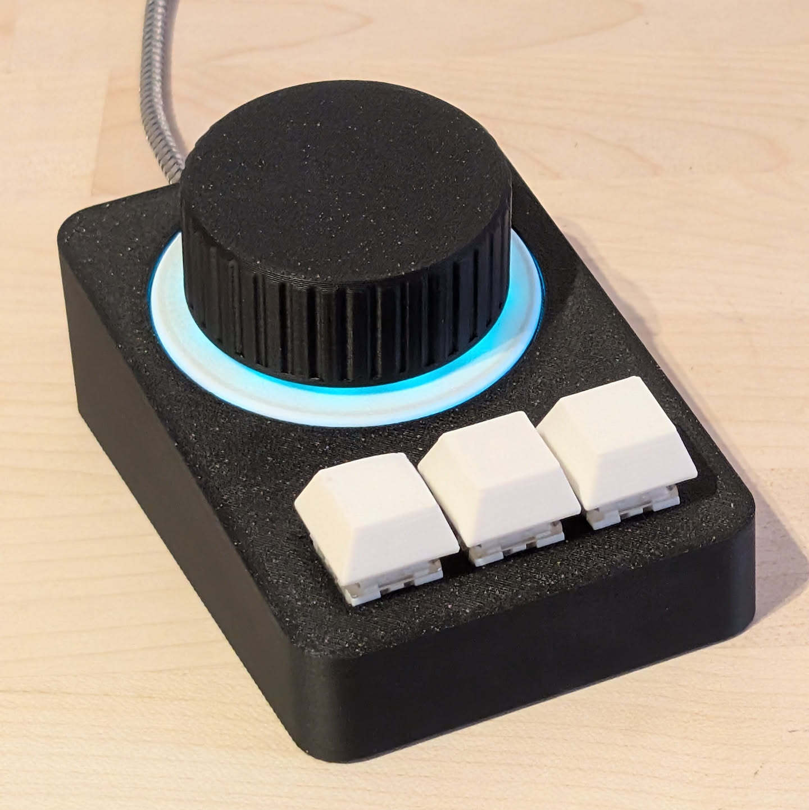
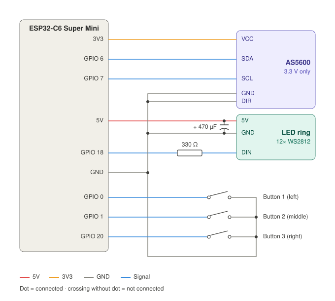

# Simple Zigbee Knob

A magnetic rotary knob with an LED halo and three MX keys for **Home Assistant via Zigbee**.
It sets three values (0–100 %) and sends button events. What they do is up to you in Home Assistant:
dim a light, set the volume of a speaker, move blinds, …



- ESP32-C6 Super Mini (native Zigbee), no hub-specific firmware required
- AS5600 magnetic angle sensor: smooth rotation, no wear, 24 virtual detents per turn
- 12× WS2812 ring under a diffuser: shows the selected value as a colored bar
- Fully parametric OpenSCAD enclosure, ready-to-print STLs included
- Zigbee2MQTT external converter included

Print files and photos are also on [MakerWorld](https://makerworld.com/en/models/3617982-zigbee-rotary-knob).

## Bill of materials

| Part | Note |
|---|---|
| ESP32-C6 Super Mini | 4 MB flash |
| AS5600 module | run it on 3.3 V, DIR to GND; 4 holes on a 16 mm square, chip centered |
| Magnet Ø4 × 2 mm | **must be diametrically magnetized**, axially magnetized magnets do not work |
| WS2812 12-LED ring Ø50 / Ø35 | other sizes: adjust `cad/knob.scad` |
| 3× MX switch + caps | caps can also be printed (`stl/keycap.stl`) |
| 330 Ω resistor | in the data line to the ring |
| 100–470 µF capacitor | across 5 V/GND at the ring (recommended) |
| 4× M3×8 countersunk | base plate, screwed directly into the plastic |
| 4× M3×8 pan head | AS5600 to the standoffs |
| 4× M3×6 pan head | diffuser (sits below the knob, head max. 2.4 mm high) |
| 4× rubber foot Ø10 | optional |

## Wiring



| ESP32-C6 | to |
|---|---|
| 3V3 | AS5600 VCC |
| GND | AS5600 GND, AS5600 DIR, ring GND, all buttons |
| GPIO 6 | AS5600 SDA |
| GPIO 7 | AS5600 SCL |
| 5V | ring 5V |
| GPIO 18 | through 330 Ω to ring DIN |
| GPIO 0 / 1 / 20 | button 1 / 2 / 3 (other side to GND) |

Pins can be changed in [firmware/src/config.h](firmware/src/config.h). The strapping pins
(4, 5, 8, 9, 15) are deliberately left unused.

- **AS5600 DIR** sets the direction in which the angle increases. Don't leave it floating, or the
  direction flips randomly. If the knob turns the wrong way, toggle `INVERT_ROTATION` in `config.h`.
- **OUT** and **PGO** on the AS5600 stay unconnected, as does **DOUT** on the ring.
- Put the capacitor and the 330 Ω resistor close to the ring.
- GPIO 2 and 3 (ADC capable) are kept free for voltage dividers (battery voltage and USB detection,
  for a later battery version). **Reading these dividers is not implemented in the firmware yet**,
  so you can leave the resistors out for now.

## Usage

| Input | Action |
|---|---|
| Long press button 1 / 2 / 3 | select value 1 / 2 / 3 (the ring wipes in the value's color) |
| Click / double click button 1 / 2 / 3 | event to Home Assistant (`action` `1_click`, `1_double_click`, …), the ring flashes once / twice |
| Rotate | change the selected value, 2 % per detent (`SIMPLE_STEP`) |
| Hold button 3 > 6 s | Zigbee factory reset (red progress bar from 1.5 s) |

Each value has its own color: 1 orange, 2 green, 3 purple (`SIMPLE_COLORS`). After a few seconds
the ring fades to a faint glow. Values, the selected value and the ring brightness survive a power cycle.

| LED ring | Meaning |
|---|---|
| bar in the value's color | current value |
| rotating dot | no Zigbee network, searching |
| slow breathing | Zigbee connection lost |
| growing red bar | button 3 held, factory reset pending |
| blinking red | AS5600 not found |

The onboard LED of the Super Mini also shows the status, which helps while testing:
fast red blinking = reset pending, slow red blinking = AS5600 not found,
orange breathing = searching for a network, green = connected, short blink = input.

## Firmware

Built with [PlatformIO](https://platformio.org/) and the **pioarduino** platform fork, because
Zigbee on the C6 needs Arduino core 3.x. The first build downloads the platform and toolchain
(a few hundred MB).

```bash
cd firmware
pio run -t upload
pio device monitor
```

If the upload does not start: hold BOOT, tap RESET, release BOOT.

The knob is a **Zigbee end device** with its receiver always on (it is USB powered). To make it a
router that strengthens the mesh, use `-DZIGBEE_MODE_ZCZR` and `zigbee_zczr.csv` in
`platformio.ini`. After changing the role, erase the flash (`pio run -t erase`) and pair again.

## Zigbee2MQTT / Home Assistant

1. Copy [zigbee2mqtt/magnet_knob_simple.mjs](zigbee2mqtt/magnet_knob_simple.mjs) to
   `<z2m-data>/external_converters/` and restart Zigbee2MQTT.
2. Enable *Permit join* and plug in the knob. If it was paired before, hold button 3 for more than 6 s.
3. Press **Reconfigure** on the device once. This sets up reporting; before that the knob does not
   report anything.

Home Assistant then gets:

| Entity | Description |
|---|---|
| `value_1` … `value_3` | the three values, 0–100 %, can also be set from HA |
| `active` | selected value 1–3 |
| `action` | button events `1_click`, `1_double_click`, `2_…`, `3_…` |
| `ring_brightness` | LED ring brightness (configuration) |

For the buttons as event entities in HA, set `homeassistant: {experimental_event_entities: true}`
in the Zigbee2MQTT configuration. Device triggers on `action` work without it.

Example automation: dim a light with value 1.

```yaml
automation:
  - alias: Knob value 1 -> desk lamp
    triggers:
      - trigger: state
        entity_id: number.magnet_knob_value_1   # depends on the device name in Z2M
    actions:
      - action: light.turn_on
        target:
          entity_id: light.desk_lamp
        data:
          brightness_pct: "{{ trigger.to_state.state | int }}"
```

<details>
<summary>Technical details</summary>

| Endpoint | Cluster | Content |
|---|---|---|
| 1–3 | Analog Input / Output | values 1–3, 0–100 % |
| 4 | Analog Input / Output | active value 1–3 |
| 5 | Analog Input / Output | ring brightness 0–100 % |
| 6 | Analog Input | button event: button n·10 + 1 click / 2 double click |

Home Assistant writes to the Analog Output cluster, the knob reports through the Analog Input
cluster. With the ESP Zigbee SDK only Analog Input reports work reliably, and only if a reporting
configuration exists for the attribute; without one the stack asserts (boot loop). The firmware
therefore checks for it before every report.

**Connection watchdog:** `Zigbee.connected()` stays true forever after the first join, so the
knob checks itself whether the network answers its packets. After 60 s of silence it sends a sign
of life; after 3 min without an answer the connection counts as lost (ring breathes), and 2 min
later it restarts and rejoins. If that fails, the wait doubles up to 1 h.

**Reconfigure fails with `configReport … FAILURE`** or the knob reports nothing: the Zigbee
storage holds broken reporting entries. Erase only the `zb_storage` partition and pair again
(values and ring brightness are kept):

```bash
esptool.py --chip esp32c6 --port /dev/ttyACM0 erase_region 0x3EB000 0x4000
```

</details>

## 3D printing

Ready-to-print STLs are in [stl/](stl/), already rotated into print orientation, no supports needed.
A ready-made print project is available on [MakerWorld](https://makerworld.com/en/models/3617982-zigbee-rotary-knob).

| Part | Material | Note |
|---|---|---|
| `shell.stl` | PETG/PLA, dark | sloped top flat on the bed |
| `base.stl` | PETG (springs better than PLA) | snap hooks for the Super Mini |
| `knob.stl` | PETG/PLA | top side on the bed |
| `diffuser.stl` | **transparent/white PETG**, 100 % infill | visible side on the bed |
| `keycap.stl` ×3 | any | optional |

[cad/knob.scad](cad/knob.scad) is fully parametric. All component dimensions are at the top of the
file, **measure your parts** (ring diameters, AS5600 board, Super Mini). Export a part with:

```bash
cd cad
openscad -D 'part="shell"' -o shell.stl knob.scad
```

Before printing the shell, the test parts are worth it: `key_test` (MX cutout: if the switch is
tight, increase `key_hole`), `mcu_test` (Super Mini snap hooks: too loose → increase `hook_pre`) and
`screw_test` (pick the best M3 core hole for `tap_d`).

Useful parameters: `tilt` (slope, default 8°), `H_front` (front height), `magnet_air_gap`
(0.5–3 mm), `halo_gap` (light gap), `ring_gap` (LED → diffuser), `diffuser_d`, `key_gap`, `clr`
(fits, printer dependent). OpenSCAD prints the critical clearances when rendering.

### Assembly

All screws are M3, screwed directly into the plastic.

1. Put the LED ring into the ring pocket, LEDs up, and route the wires through the slot at the
   front. Place the diffuser on top and fix it with 4× M3×6. Its holder tube presses on the ring PCB
   and holds the ring.
2. Mount the AS5600 from below, chip facing up, against the 4 standoffs with 4× M3×8. The
   standoffs set the air gap to the magnet. Solder the wires directly (no pin header), space is tight.
3. Glue the magnet into the core at the bottom of the knob shaft and let it cure. Push the knob into
   the boss until the fingers snap in.
4. Clip the switches into the plate and wire them.
5. Press the Super Mini (wires soldered from the top) between the snap hooks of the base plate,
   USB socket to the back, until both side hooks click in. To remove it, bend the hooks outward slightly.
6. Screw on the base plate with 4× M3×8 countersunk screws.

## License

[MIT](LICENSE) – firmware, Zigbee2MQTT converter, CAD files and STLs.
